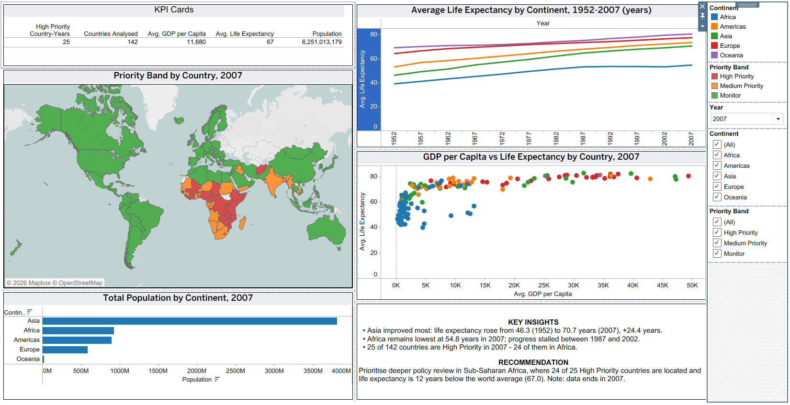
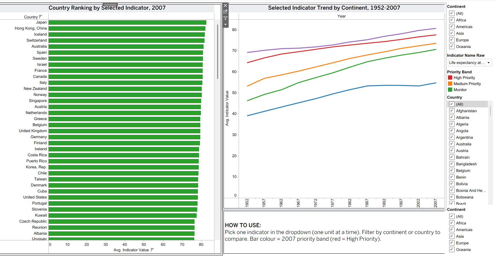
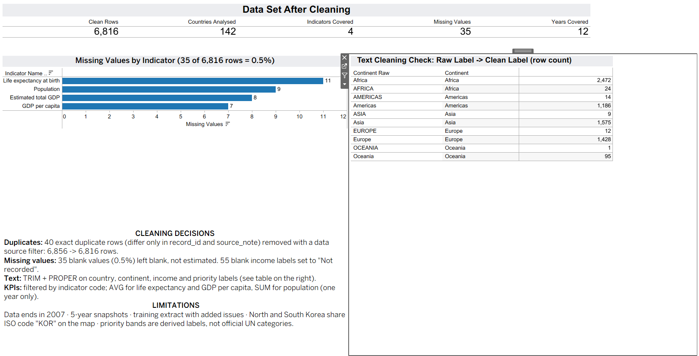
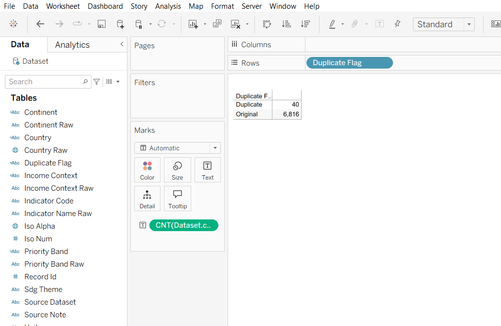

# 🌍 Global Development Indicators Dashboard | Tableau

**Where should development leadership focus first?** An interactive Tableau dashboard that turns 55 years of country-level health, population, and economic data (1952–2007, 142 countries) into clear priorities and evidence-based recommendations.


<!-- After publishing to Tableau Public, replace this comment with:
**🔗 [View the interactive dashboard on Tableau Public](YOUR-LINK-HERE)**
-->



---

## 📌 Business Problem

A development analytics team needs a clear, decision-ready view of how **life expectancy, population, and GDP per capita** changed across countries and regions, so leadership can:

- compare regional progress over time,
- identify **high-priority countries** that need deeper policy review, and
- back every recommendation with exact numbers.

## 🎯 Key Results (2007)

| Avg. life expectancy | Total population | Avg. GDP per capita | Countries analysed | High-priority countries |
|:---:|:---:|:---:|:---:|:---:|
| **67.0 years** | **6.25 billion** | **$11,680** | **142** | **25** |

## 💡 Key Insights

1. **Asia improved the most.** Average life expectancy rose from 46.3 years (1952) to 70.7 years (2007), a gain of **+24.4 years**. The Americas gained +20.3, Africa +15.7, Europe +13.2 and Oceania +11.5.
2. **Africa's progress stalled.** Africa's average life expectancy was 53.3 years in 1987 and still 53.3 in 2002. In 2007 it was 54.8 years, **22.8 years below Europe** (77.6).
3. **High-priority contexts are concentrated in Africa.** In 2007, **24 of the 25** high-priority countries were in Africa (the other was Afghanistan). That is down from 79 high-priority countries in 1952, so progress is real but uneven.
4. **Income matters, but not on its own.** Higher GDP per capita goes with higher life expectancy, levelling off above about $10,000. But Botswana ($12,570; 50.7 years) and South Africa ($9,270; 49.3 years) show that income alone does not explain health outcomes.
5. **Scale is in Asia.** Asia holds 3.81 billion of the 6.25 billion people analysed (**61%**). Asia and Africa together hold 76%, so they have the largest planning impact.

## ✅ Recommendations

| # | Recommendation | Evidence in the dashboard |
|---|---|---|
| 1 | **Prioritise Sub-Saharan Africa for deeper policy review**, starting with the 24 high-priority countries | Priority map + KPI cards filtered to Africa |
| 2 | **Investigate why Africa's life expectancy stalled from 1987 to 2002** before designing new programmes | Flat Africa line (~53 years for 15 years) on the trend chart |
| 3 | **Look beyond income** in middle-income countries with low life expectancy, and review health-system indicators | GDP vs. life expectancy scatter plot (Botswana, South Africa) |

> These recommendations are based on data that ends in 2007 and should be confirmed with current data before policy decisions (see Limitations below).

---

## 📊 Dashboard Walkthrough

### 1. Executive Summary
KPI cards, life-expectancy trend by continent, priority-band map, population by continent, GDP vs. life-expectancy scatter plot, and an insight + recommendation panel. Filters: year, continent, priority band.

### 2. Country Deep Dive
Ranked country bar chart and continent trend line for an indicator chosen from a dropdown, with continent and country filters. Bars are coloured by priority band so high-priority countries stand out.



### 3. Data Quality & Method
Makes the work auditable: clean-data summary, missing values by indicator, a raw-to-clean label check, cleaning decisions, and limitations.



---

## 🧹 Data Preparation (all done inside Tableau)

The source was a long-format table (one row per country × year × indicator) with **6,856 rows and 15 columns**. It contained realistic quality issues: inconsistent casing, extra spaces, blank labels, missing values and duplicate rows. The raw file was not edited; every fix is a documented Tableau calculated field or filter.

| Issue | What I did | Result |
|---|---|---|
| Inconsistent text (e.g. `" angola "`, `"AFRICA "`) | `PROPER(TRIM([field]))` on country, continent, priority band | 184 country spellings → **142 countries**; 10 continent variants → **5**; 6 priority variants → **3** |
| Messy income labels + blanks | Trimmed, replaced hyphens, fixed case; blanks labelled `"Not recorded"` (not guessed) | 8 variants → **4 categories** + 55 "Not recorded" |
| Hidden duplicates | A check excluding only `record_id` found none, because duplicates also differed in `source_note`. Flagged them with `CONTAINS([source_note], "DUPLICATE")` and removed them with a data source filter | **40 duplicates removed**: 6,856 → **6,816 rows** (142 countries × 12 years × 4 indicators) |
| Missing values | Counted by indicator with `ISNULL([indicator_value])`; left blank rather than estimated | **35 missing (0.5%)**, shown on the Data Quality page |
| Mixed units in one value column | One KPI field per indicator code, so units are never mixed; AVG for rates, SUM for population (single year only) | Correct, comparable KPIs |



<details>
<summary><b>Calculated fields used</b></summary>

```text
// Cleaning
Country        = PROPER(TRIM([country_raw]))
Continent      = PROPER(TRIM([continent_raw]))
Priority Band  = PROPER(TRIM([priority_band_raw]))
Income Context = IF ISNULL([income_context_raw]) OR TRIM([income_context_raw]) = ""
                 THEN "Not recorded"
                 ELSE PROPER(REPLACE(TRIM([income_context_raw]), "-", " "))
                 END
Duplicate Flag     = IF CONTAINS([source_note], "DUPLICATE") THEN "Duplicate" ELSE "Original" END
Missing Value Flag = IF ISNULL([indicator_value]) THEN "Missing" ELSE "Has value" END

// KPIs (one field per indicator so units are never mixed)
Life Expectancy = IF [indicator_code] = "HEALTH_LE"   THEN [indicator_value] END
Population      = IF [indicator_code] = "POP_TOTAL"   THEN [indicator_value] END
GDP per Capita  = IF [indicator_code] = "ECON_GDP_PC" THEN [indicator_value] END
Countries Analysed = COUNTD([Country])
High Priority Country-Years =
    COUNTD(IF [Priority Band] = "High Priority" THEN [Country] + "-" + STR([year_raw]) END)

// Data quality page
Missing Values     = SUM(IF ISNULL([indicator_value]) THEN 1 ELSE 0 END)
Years Covered      = COUNTD([year_raw])
Indicators Covered = COUNTD([indicator_code])
```
</details>

---

## 🛠️ Skills Demonstrated

- **Data cleaning & validation** in Tableau (TRIM/PROPER, null handling, duplicate detection, data source filters)
- **KPI design**: choosing the right aggregation (AVG vs. SUM) and avoiding mixed units in long-format data
- **Dashboard design**: executive summary, analyst deep dive, and an auditable method page
- **Geospatial visualisation** with ISO country codes
- **Interactivity**: year, continent, country, priority-band and indicator filters
- **Data storytelling**: insights and recommendations tied to exact dashboard evidence

## ⚠️ Limitations

- Data ends in **2007** and uses **5-year snapshots**, so it does not show current conditions or year-to-year changes.
- **35 values (0.5%)** are missing and 55 income labels are "Not recorded"; averages use available values only.
- Priority bands and income contexts are **derived labels**, not official classifications.
- Averages are **unweighted** country averages (a small country counts as much as a large one).
- North and South Korea share the ISO code `KOR` in the source, so the map shows them as one location.

## 📁 Repository Structure

```text
├── README.md
├── tableau/
│   └── Global_Development_Dashboard.twb    # Tableau workbook (no data embedded)
├── images/                                  # Dashboard screenshots
├── docs/
│   ├── Global_Development_Indicators_Report.pdf      # 4-page analysis report
│   └── Global_Development_Dashboard_Presentation.pdf # 7-slide summary deck
└── data/
    └── README.md                            # Data source & schema (data not included)
```

## ▶️ How to Open the Workbook

The dataset is **not included** in this repository (see [`data/README.md`](data/README.md)).
To explore the workbook, open `tableau/Global_Development_Dashboard.twb` in Tableau Desktop or Tableau Public. When Tableau asks for the data source, point it to a CSV with the schema described in `data/README.md`.

## 📚 Data Source

Data based on **Gapminder** public development indicators, accessed through **Plotly** sample data.
[gapminder.org/data](https://www.gapminder.org/data/) · [Plotly datasets](https://plotly.com/python-api-reference/generated/plotly.data.html)

*Independent portfolio project. Not affiliated with Gapminder, Plotly, or the United Nations.*

---

**Mehwish Naseeruddin** · Data Analyst
<!-- Add your links, for example: [LinkedIn](https://www.linkedin.com/in/your-profile) · [Tableau Public](https://public.tableau.com/app/profile/your-profile) -->
